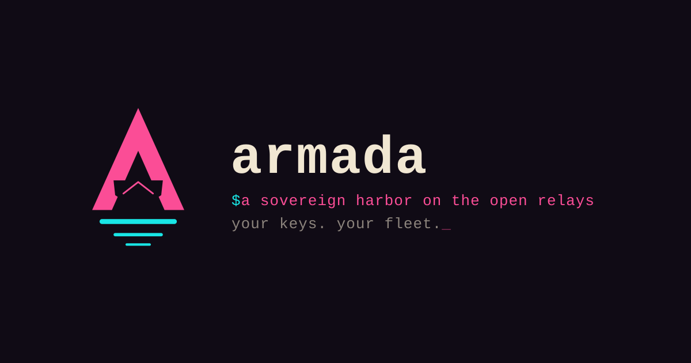

# armada

Self-host [Armada](https://armada.buzz) on your own server. `armada` is one
static binary that serves everything Armada needs, from one domain:

- **The web app**, fetched from Nostr as an nsite and kept up to date on its
  own, and told to use this server first.
- **A Nostr relay** for the kinds Armada uses: communities, DMs, profiles.
- **A Blossom server** for encrypted attachments.
- **Push notifications**, for DMs and Concord channels on this relay.
- **Voice and video calls**, on a LiveKit built into the binary.
- **HTTPS**, with a certificate from Let's Encrypt, and **an onion
  address**, over a Tor built in as well.

There's no database, reverse proxy, Docker or Tor daemon to set up.

## Install

On a Linux server (x86_64 or aarch64) with systemd, with your domain pointed
at it and ports 80, 443 and 7881/tcp and 7882/udp open:

```sh
curl -fsSL https://armada.buzz/install.sh | sudo sh -s -- armada.example.com
```

It installs the latest release, from a package repository on Debian, Ubuntu,
Fedora and RHEL, sets up the service, and gets the certificate, in about a
minute. Then open `https://armada.example.com`. To upgrade later, run the
installer again, or let `apt upgrade` or `dnf upgrade` do it.

[INSTALL.md](INSTALL.md) goes through it step by step, and covers Tor,
taking a community down by its invite link, backups, calls, running behind a reverse proxy, installing by hand and
building from source. [`armada.example.toml`](armada.example.toml) lists
every setting, and [CHANGELOG.md](CHANGELOG.md) what each release changed.

## Releases

Releases are published on Nostr with [ngit](https://ngit.dev), signed by
`npub10qdp2fc9ta6vraczxrcs8prqnv69fru2k6s2dj48gqjcylulmtjsg9arpj`, and the
binaries are stored on Blossom. The repository is at:

```
nostr://npub10qdp2fc9ta6vraczxrcs8prqnv69fru2k6s2dj48gqjcylulmtjsg9arpj/git.shakespeare.diy/armada-stack
```

## License

[AGPL-3.0-only](LICENSE).
